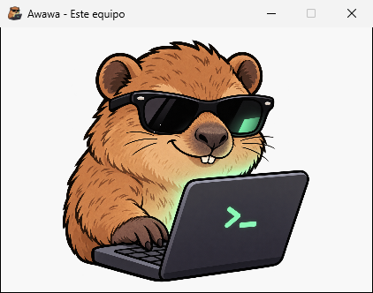
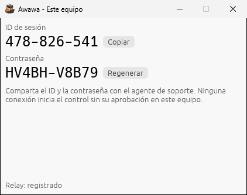
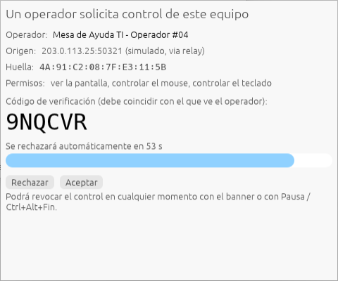
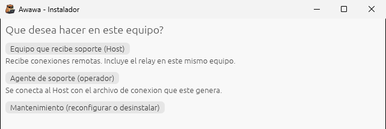
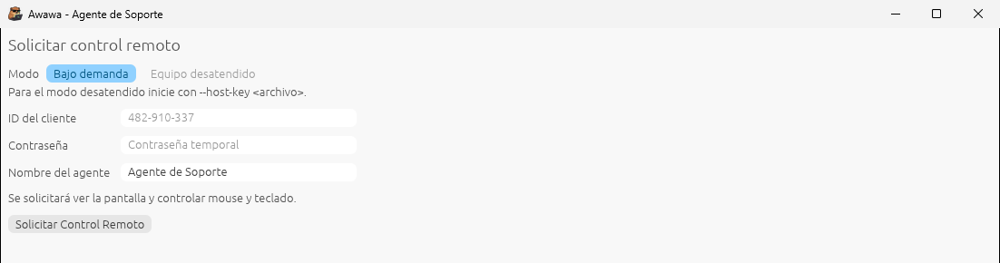

<p align="center">
  
</p>

<h1 align="center">Awawa</h1>

<p align="center">Soporte remoto para Windows escrito en Rust, con aprobación local obligatoria y cifrado de extremo a extremo.</p>

---

## ¿Qué es?

Awawa permite que un agente de soporte vea y controle el escritorio de otro equipo Windows. El equipo asistido genera un ID y una contraseña de un solo uso. La persona que está frente a él debe aprobar cada conexión, y mientras dura el control ve siempre un aviso de que su equipo está siendo controlado.

## Capturas

<table>
  <tr>
    <td align="center" width="50%">
      <br>
      <sub><b>Pantalla de inicio.</b> Se muestra 3 segundos al abrir la aplicación.</sub>
    </td>
    <td align="center" width="50%">
      <br>
      <sub><b>Este equipo.</b> ID y contraseña de un solo uso para compartir con el agente.</sub>
    </td>
  </tr>
  <tr>
    <td align="center">
      <br>
      <sub><b>Aprobación local.</b> El usuario ve quién pide el control, qué permisos solicita y el código de verificación.</sub>
    </td>
    <td align="center">
      <br>
      <sub><b>Instalador.</b> Elige el rol de este equipo o reconfigura una instalación.</sub>
    </td>
  </tr>
</table>

<p align="center">
  <br>
  <sub><b>Agente de soporte.</b> Solicita el control bajo demanda o se conecta a un equipo desatendido.</sub>
</p>

<p align="center">
  <br>
  <sub><b>Control activo.</b> Banner siempre visible con quién controla, el tiempo transcurrido y el botón para revocar.</sub>
</p>

## Funcionalidades

- **Soporte bajo demanda.** El equipo asistido genera un ID y una contraseña efímeros con un generador aleatorio criptográfico. Nada se reutiliza entre sesiones.
- **Aprobación local obligatoria.** Ninguna sesión toma el control sin que el usuario del equipo la acepte en un diálogo de consentimiento. Mientras dura el control, un banner lo indica y permite cortarlo.
- **Cifrado de extremo a extremo.**
  - El canal se establece con un intercambio de claves autenticado por contraseña (SPAKE2), se deriva con HKDF y se cifra con ChaCha20-Poly1305.
  - Ambos lados muestran un código de verificación (SAS) para compararlo.
- **Relay ciego.**
  - Un relay QUIC (UDP 4433) empareja a ambas partes sin poder leer el tráfico.
  - Las sesiones caducan (TTL) y hay límite de conexiones por IP.
  - Los clientes fijan la clave del relay (pin del certificado).
- **Captura de pantalla eficiente.** Usa DXGI Desktop Duplication o Windows Graphics Capture, con respaldo GDI. Solo envía los mosaicos que cambian, comprimidos con zstd.
- **Control de teclado y ratón seguro.** La entrada se inyecta con `SendInput` solo mientras haya una sesión aprobada y activa. Si se pierde el latido o se revoca la sesión, se liberan todas las teclas y botones.
- **Acceso desatendido (opcional).**
  - Un servicio de Windows permite conectarse con una contraseña persistente.
  - Esa contraseña se guarda como verificador Argon2id protegido con DPAPI, nunca en texto plano.
  - Las operaciones quedan auditadas y se muestra un banner en la sesión del usuario.
- **Instalador gráfico.** `Awawa-Setup` instala el rol *Equipo que recibe soporte* (receptor, relay local y, opcionalmente, acceso desatendido) o el rol *Agente de soporte*.
  - Lleva los binarios embebidos y verifica su SHA-256 al extraerlos.
  - Genera un archivo de conexión (`.rrs`) sin secretos.
  - Permite reconfigurar o desinstalar.
- **Ejecutables endurecidos.** Runtime de C enlazado de forma estática, Control Flow Guard activo, manifiestos con DPI PerMonitorV2 y compilación reproducible.

## Componentes

| Crate | Descripción |
|---|---|
| `awawa-host` | Receptor: muestra el ID y la contraseña, y pide la aprobación local. |
| `awawa-operator` | Consola y visor del agente de soporte. |
| `awawa-relay` | Relay ciego QUIC. |
| `awawa-service` | Servicio de acceso desatendido, agente de sesión y herramienta `awawa-admin`. |
| `awawa-installer` | Instalador gráfico `Awawa-Setup`. |
| `awawa-protocol` | Protocolo, credenciales efímeras, handshake y máquina de estados del consentimiento. |
| `capture-win` | Captura del escritorio (DXGI / WGC / GDI). |
| `input-win` | Inyección de teclado y ratón vinculada a la sesión aprobada. |

## Compilación

Requisitos: Windows x64, Rust (edición 2024, toolchain MSVC) y el Windows SDK, que aporta `rc.exe` para incrustar los manifiestos y el icono.

```powershell
cd rust-workspace
cargo build --workspace --release
```

Validación completa: build, pruebas, clippy, cargo-deny y rustfmt.

```powershell
powershell -ExecutionPolicy Bypass -File scripts\validate.ps1
```

Paquete portable e instalador:

```powershell
powershell -ExecutionPolicy Bypass -File scripts\package.ps1
```

`package.ps1` deja en `dist\` lo siguiente:

- la carpeta `Awawa-<version>\`, con los ejecutables y `SHA256SUMS.txt`;
- el instalador `Awawa-Setup-<version>.exe`.

Para firmar con Authenticode se agrega `-CertThumbprint <huella>`.

## Uso rápido

1. En el equipo que recibe soporte, ejecuta `Awawa-Setup` y elige el rol **Equipo que recibe soporte**. Copia el archivo de conexión `.rrs` que genera.
2. En el equipo del agente, ejecuta `Awawa-Setup`, elige **Agente de soporte** y carga el `.rrs`.
3. En el equipo asistido, abre **Awawa - Este equipo** y comparte el ID y la contraseña con el agente.
4. El agente se conecta desde **Awawa - Agente de Soporte** y el usuario aprueba la solicitud.

## Licencia

Consulta el archivo [LICENSE](LICENSE).
